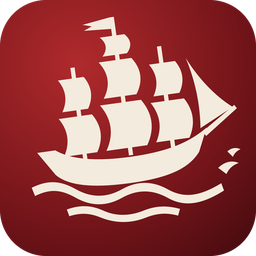
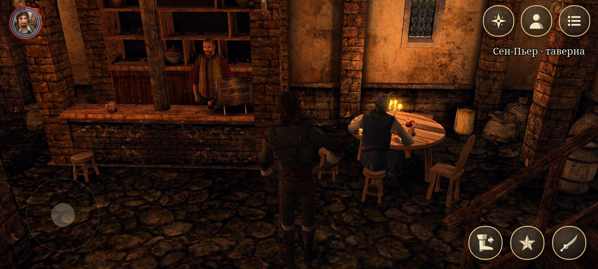
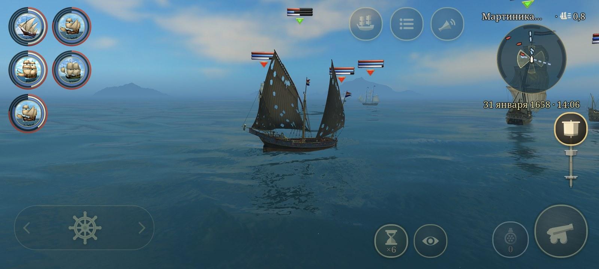
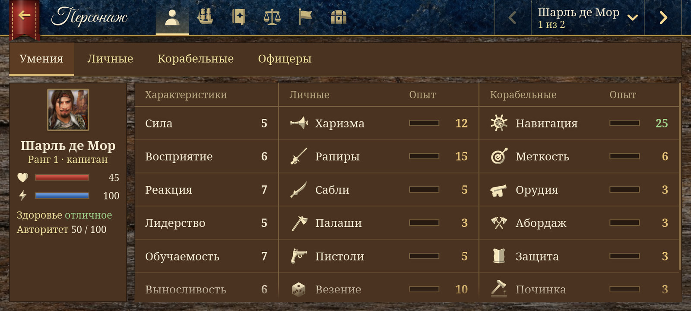

**English** | [Русский](README.ru.md)

<p align="center"></p>

# Seawolves

Sea Dogs: To Each His Own («Корсары: Каждому своё») on an Android phone, from your own copy of the game.

Seawolves is an unofficial fan port: a touch interface and a port of the game's open-source engine,
[Storm Engine](https://github.com/storm-devs/storm-engine). **It contains no game files** — you need your own
legally obtained copy.

**Status: first public alpha.** The game starts, plays and saves; a full playthrough has not been verified.
Expect bugs and please [report them](#reporting-a-bug).

<p align="center">
  
</p>
<p align="center">
  
</p>
<p align="center">
  
</p>

<sub>The game's graphics in the screenshots belong to its rights holders and are not covered by this repository's
licence ([NOTICE](NOTICE)).</sub>

## Quick start

1. **Get the game**: version `ver. 1.7.3 (26.11.21) x64`, installed on a computer or as an archive or installer.
2. **Install the app**: download the APK from [Releases](https://github.com/maxyo/seawolves/releases), open it on
   the phone and allow the installation when Android asks.
3. **Import the game**: start Seawolves, open **Game files** and pick the game's folder, its ZIP, 7z or RAR archive,
   or `setup.exe` together with all its `setup-*.bin` files.
4. **Play.**

Other game versions start too, but the fixes to the game's scripts are applied only to 1.7.3.

## Requirements

| | Minimum | Recommended |
|---|---|---|
| Android | 8.0 | 12 or newer |
| Processor | 64-bit ARM | 64-bit ARM |
| RAM | 4 GB | 8 GB |
| Free storage | 15 GB | 20 GB |
| GPU | mid-range of 2021 or newer | flagship of 2023 or newer |

Played on Galaxy S24, Xiaomi 15 Ultra and Pixel 10 Pro.

<details>
<summary>GPUs in detail and what was tested</summary>

| GPU family | Minimum | Recommended | Too slow |
|---|---|---|---|
| Adreno | 642L, 644, 660, 710, 720 | 740, 750, 830 | 610, 612, 618, 619 |
| Mali | G68 MC4, G610 MC6, G615, G715 MC7 | — | G52, G57 |
| Immortalis | all | G715 MC11, G720, G925 | — |
| Xclipse | 530, 540, 920 | 940, 950 | — |
| PowerVR | D-Series DXT-48-1536 | — | GE8320, GE8322 |

- The game draws with Vulkan 1.1 where the phone's driver is fit for it and with OpenGL ES 3.2 otherwise.
- On the minimum it runs at the Low preset; the recommended GPUs run Medium or High.
- It takes 0.6–1.1 GB of RAM and 12.7 GB of storage for the game, plus up to 2 GB of caches.
- **Played**: Galaxy S24 (Adreno 750), Xiaomi 15 Ultra (Adreno 830), Pixel 10 Pro (PowerVR D-Series, OpenGL ES).
- **Start, a loaded save and the presets measured**: Galaxy S23 (Adreno 740), Galaxy S21 (Adreno 660), Galaxy A56
  (Xclipse 540), Pixel 8 (Mali-G715), on Android 12 and 16.
- **Not supported**: Galaxy A12 (PowerVR GE8320), 2–5 frames a second.
- Everything else in the table is an estimate from public GPU benchmarks, not a measurement.

</details>

## Good to know

- **Uninstalling deletes the game and the saves.** Send the saves out first with **About → Send a save** and bring
  them back with **Restore a save**.
- **Updates** install over the previous release and keep everything.
- **Download** in the app fetches a copy you are entitled to from your own torrent file or magnet link. The app
  has no links to the game.
- **Texture processing** (Settings → Sound & graphics): Normal maps, Parallax and Texture upscaling ×2, off by
  default. The phone makes them from your game files.

<details>
<summary>Verifying the download</summary>

```sh
sha256sum --check SHA256SUMS
apksigner verify --print-certs seawolves-<version>-arm64.apk
# Signer #1 certificate SHA-256 digest: 31c67a4b0d1471f1e800dc498b07b0c65d5268167bfc7b578fb8dd5f6e7879ea
```

Every release is signed with this one key. A build from source is signed with another key, so it cannot update a
release and a release cannot update it.

</details>

## What it does

- Touch controls on land, at sea and on the world map, with haptics and a left-handed layout.
- A redesigned interface in Russian, English, German, Spanish, French and Italian.
- Vulkan or OpenGL ES, three quality presets with an automatic choice, reworked lighting and shadows.
- The game's videos, autosaves, sending and restoring saves.
- Fixes to bugs in the game's own scripts. Pirates on the world map are rarer by default (Settings → Pirates on the
  world map).

Changes by version are in the [changelog](CHANGELOG.md).

## Reporting a bug

In the launcher open **About → Share a report** and attach the file to a new
[issue](https://github.com/maxyo/seawolves/issues). If the bug depends on a save, add it with **Send a save**.
Security problems: [SECURITY.md](SECURITY.md).

## Plans

No dates and no promises: an iOS port, a mod manager, other games of the Sea Dogs series and Caribbean Legend.

## Building

On Linux with JDK 17, Python 3.12+, CMake, Ninja, a C++ compiler, FFmpeg, curl, unzip, patch, Perl and make:

```sh
git clone https://github.com/maxyo/seawolves.git
cd seawolves
bash app/tools/android/build_debug.sh
```

The first build downloads the Android NDK and SDK and writes the debug APK to `app/build/dist/`. It needs no game
files. More in [CONTRIBUTING.md](CONTRIBUTING.md), the [application guide](app/tools/android/README.md) and the
[engine README](engine/README.md).

| Path | What |
|---|---|
| `app/android/` | the Android shell: launcher, game import, the game activity |
| `app/mobile-ui/` | the touch interface and its scripts |
| `app/script-patches/` | fixes to the game's scripts, as diffs |
| `app/tools/android/`, `app/tests/` | packaging, release tools, checks |
| `engine/` | the native engine: C++, the renderer and its shaders, tests and tools |

## Licence and credits

[GPL-3.0](LICENSE): the engine, the interface scripts and the script fixes are GPL-3.0-only, the rest of the
application GPL-3.0-or-later. Details and the origin of every font, icon and texture are in [NOTICE](NOTICE);
third-party libraries are listed in [engine/third_party/README.md](engine/third_party/README.md).

The engine is a fork of [storm-devs/storm-engine](https://github.com/storm-devs/storm-engine) (`develop` at
`a68f43df`). Thanks to the authors of Storm Engine and of the game for opening their code, and to the storm-devs
community that maintains it and published the game's scripts in
[sd-teho-public](https://github.com/storm-devs/sd-teho-public). Thanks also to Claude and Codex, the AI assistants
that helped write this port.

Dustoff is the studio name under which Seawolves is released.

## Disclaimer

Seawolves is not affiliated with or endorsed by the developers, publishers or rights holders of Sea Dogs: To Each
His Own or of the Sea Dogs series; their names and trademarks belong to their owners. The game's content is not
part of this project and is not covered by its licence. The project does not distribute the game: use a copy you
own. The software comes with no warranty.
