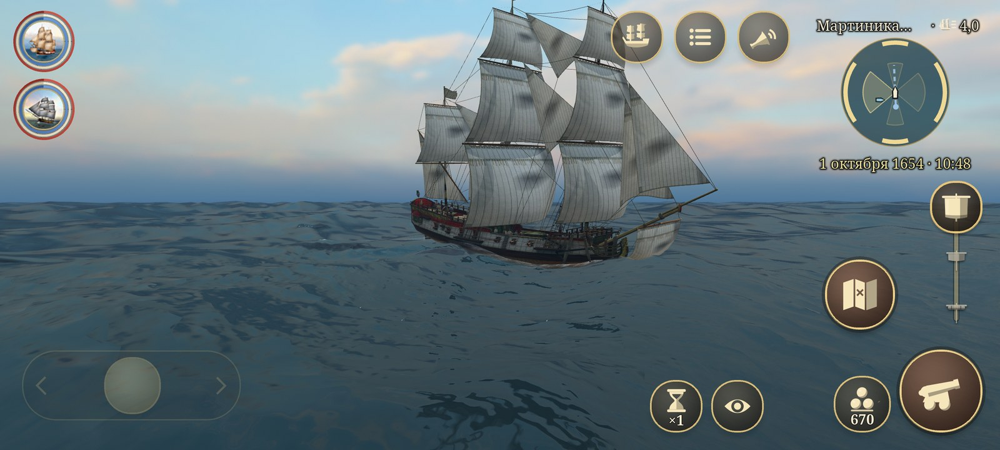

[English](README.md) | **Русский**

# Seawolves

Seawolves — приложение для Android, которое запускает «Корсары: Каждому своё» (Sea Dogs: To Each His Own) на
телефоне из вашей собственной копии игры. Оно состоит из Android-оболочки с сенсорным интерфейсом (`app/`) и
форка [Storm Engine](https://github.com/storm-devs/storm-engine), открытого движка игры, перенесённого на Android
(`engine/`).

Это неофициальный фанатский проект, не связанный с правообладателями игры. **В репозитории и в APK нет файлов
игры.** Нужна своя легально полученная копия.

**Состояние: первая публичная альфа.** Игра запускается, идёт и сохраняется на телефонах из раздела
[Требования](#требования); полное прохождение не проверено, устройства вне этого списка не проверялись. Ошибки
будут — пожалуйста, [сообщайте о них](#как-сообщить-об-ошибке).

## Скриншоты

<p align="center">
  <br>
  <em>В помещении: таверна Сен-Пьера ночью, при свечах и огне очага.</em>
</p>
<p align="center">
  <br>
  <em>В море: корвет под всеми парусами, камера от третьего лица.</em>
</p>
<p align="center">
  <br>
  <em>Окно персонажа, вкладка навыков.</em>
</p>

На скриншотах игра запущена в приложении. Графика игры на них принадлежит правообладателям игры, показана только
для иллюстрации и не подпадает под лицензию этого репозитория ([NOTICE](NOTICE)).

## Что понадобится

- **Игра**: «Корсары: Каждому своё», версия `ver. 1.7.3 (26.11.21) x64`, установленная на компьютере либо в виде
  архива или установщика. Другие версии тоже запускаются, но исправления скриптов игры сделаны под эту версию и
  на любой другой пропускаются, а сами другие версии не проверялись. Версию вашей копии показывает файл отчёта
  (см. [Как сообщить об ошибке](#как-сообщить-об-ошибке)).
- **Телефон**, подходящий под требования ниже, и около 15 ГБ свободного места.

## Требования

| | Минимальные | Рекомендуемые |
|---|---|---|
| Android | 7.0 (API 24) | 12 и новее |
| Процессор | 64-битный ARM (arm64-v8a) | 64-битный ARM (arm64-v8a) |
| Оперативная память | 4 ГБ | 8 ГБ |
| Свободное место | 15 ГБ | 20 ГБ |
| GPU | Vulkan 1.1 или OpenGL ES 3.2, средний класс 2021 года и новее | флагманский GPU 2023 года и новее |

| Семейство GPU | Минимальные | Рекомендуемые | Ниже минимальных |
|---|---|---|---|
| Adreno | 642L, 644, 660, 710, 720 | 740, 750, 830 | 610, 612, 618, 619 |
| Mali | G68 MC4, G610 MC6, G615, G715 | — | G52, G57 |
| Immortalis | — (все выше минимума) | G715, G720, G925 | — |
| Xclipse | 530, 540, 920 | 940, 950 | — |
| PowerVR | D-Series DXT-48-1536 | — | GE8320, GE8322 |

Движок рисует через Vulkan 1.1 там, где у телефона есть рабочий драйвер, иначе через OpenGL ES. APK
устанавливается на любой телефон с OpenGL ES 3.0 — этого движку достаточно, чтобы запуститься; ниже указанного
минимума игра слишком медленная. Телефон, который явно не дотягивает до минимума (меньше 3 ГБ памяти, нет ни
Vulkan 1.1, ни OpenGL ES 3.2, или самый лёгкий пресет графики медленнее 60 мс на кадр на титульном экране),
получает одно предупреждение в лаунчере; игра всё равно запускается.

На минимальных требованиях игра идёт на пресете «Низкая»; рекомендуемые GPU тянут «Среднюю» или «Высокую». Игра
занимает 0,6–0,9 ГБ оперативной памяти. Место: 12,7 ГБ под игру и до примерно 2 ГБ под кэши, которые приложение
создаёт на телефоне (увеличенные текстуры, карты рельефа, шейдеры); рекомендуемая цифра оставляет место под архив,
из которого вы импортируете.

**В игру играли** на Galaxy S24 (Adreno 750), Xiaomi 15 Ultra (Adreno 830) и Pixel 10 Pro (PowerVR D-Series, на
OpenGL ES). Запуск, загруженное сохранение и пресеты графики также **измерены** на Galaxy S23 (Adreno 740),
Galaxy S21 (Adreno 660), Galaxy A56 (Xclipse 540) и Pixel 8 (Mali-G715), на Android 12 и 16. Galaxy A12
(PowerVR GE8320) выдаёт 2–5 кадров в секунду и не поддерживается. Остальные GPU в таблице, цифры памяти и Android
ниже 12 — **оценки** по открытым тестам GPU, а не измерения.

## Установка

1. Скачайте `seawolves-<версия>-arm64.apk` и `SHA256SUMS` со страницы
   [Releases](https://github.com/maxyo/seawolves/releases).
2. При желании проверьте скачанное. Контрольная сумма:

   ```sh
   sha256sum --check SHA256SUMS
   ```

   и подпись (`apksigner` входит в Android SDK build tools); все выпуски подписаны одним ключом, у его
   сертификата такой отпечаток SHA-256:

   ```sh
   apksigner verify --print-certs seawolves-<версия>-arm64.apk
   # Signer #1 certificate SHA-256 digest: 01096bac94d9135ed3e45ff23bbe78f002ca09fb5aa7e1a5f16e44810ab09749
   ```

3. Откройте APK на телефоне и, когда Android спросит, разрешите браузеру или файловому менеджеру установку
   приложений. Обновления ставятся поверх прежней версии; игра и сохранения остаются.

## Импорт игры

Запустите Seawolves и откройте **«Файлы игры»**. Выберите одно из двух:

- **«Папка с игрой»**: скопируйте папку установленной игры с компьютера на телефон и укажите её (подойдёт и
  папка выше);
- **«Архив или установщик»**: архив игры ZIP, 7z или RAR (можно из нескольких частей) либо установщик —
  `setup.exe` вместе со всеми его `setup-*.bin`, выбранные одновременно.

Приложение копирует игру в своё хранилище и проверяет её; после этого **«Играть»** запускает игру. Экран
**«Скачать»** загружает копию, на которую у вас есть право, по вашему torrent-файлу или magnet-ссылке; ссылок на
игру в самом приложении нет.

## Что оно умеет

- Сенсорное управление: плавающий стик, обзор свайпом, кнопки действий и способностей, морской HUD с плавающими
  штурвалом и рычагом парусов, боезапасом и приказами, вибрация, раскладка «Под левую руку».
- Переработанный интерфейс меню, сохранений, настроек, героя, корабля, торговли, верфи, журнала и диалогов на
  русском, английском, немецком, испанском, французском и итальянском.
- Графика для телефонов: Vulkan или OpenGL ES, пресеты качества, в том числе автоматический, карты рельефа и
  глянца и ×2 увеличение текстур, которые создаются на телефоне из ваших файлов игры.
- Видеоролики игры, автосохранения в трёх чередующихся записях, отправка и восстановление сохранений, файл
  отчёта для сообщений об ошибках.
- Исправления ошибок в собственных скриптах игры, которые применяются к вашей копии при запуске. Одно из них —
  не исправление, а настройка баланса: случайные встречи с пиратами на глобальной карте по умолчанию происходят
  с частотой 20 % от игровой («Настройки» → «Частота пиратов на карте»; «Часто» — как в исходной игре).

Изменения по версиям — в [списке изменений](CHANGELOG.md).

## Планы

Без сроков и обещаний, в порядке, который может поменяться:

- **Порт под iOS.**
- **Менеджер модов**: ставить, включать и выключать моды из приложения.
- **Порядок в коде**: общий код интерфейса — в движок, доработать язык скриптов игры, а интерфейс самой игры
  перенести из C++ в скрипты.
- **Другие игры серии** «Корсары» на этом же движке.
- **Caribbean Legend.**

## Как сообщить об ошибке

В лаунчере откройте **«О программе» → «Поделиться отчётом»** и сохраните файл: в нём логи приложения, модель
телефона, GPU и версия вашей копии игры. Приложите его к новому сообщению в
[Issues](https://github.com/maxyo/seawolves/issues). Если ошибка зависит от сохранения, добавьте его кнопкой
**«Отправить сохранение»** на том же экране. Об уязвимостях — см. [SECURITY.md](SECURITY.md).

## Сборка

На Linux с JDK 17, Python 3.12 или новее, CMake, Ninja, ccache, компилятором C++, FFmpeg, curl, unzip, patch,
Perl и make:

```sh
git clone https://github.com/maxyo/seawolves.git
cd seawolves
bash app/tools/android/build_debug.sh
```

Первая сборка скачивает закреплённые версии Android NDK и SDK и открытые зависимости, собирает движок и кладёт
отладочный APK в `app/build/dist/`. Файлы игры для сборки не нужны.
Проверки, которым не нужен телефон:

```sh
python3 app/tools/android/run_host_tests.py          # приложение
(cd engine && python3 tools/ci/run_host_tests.py)    # движок
```

Подробнее — в [CONTRIBUTING.md](CONTRIBUTING.md), [руководстве разработчика приложения](app/tools/android/README.md)
и [README движка](engine/README.md) (на английском).

## Карта репозитория

| Путь | Что там |
|---|---|
| `app/android/` | Android-оболочка на Java: лаунчер, импорт игры, игровая Activity, отправка файлов |
| `app/mobile-ui/design/` | пакет сенсорного интерфейса: шаблоны, стили, строки, иконки, шрифты |
| `app/mobile-ui/PROGRAM/` | интерфейсные скрипты, работающие вместе со скриптами игры |
| `app/script-patches/` | исправления опубликованных скриптов игры в виде диффов |
| `app/tools/android/`, `app/tests/` | упаковка APK, инструменты выпуска, проверки на хосте |
| `engine/` | нативный движок: C++, рендерер на bgfx и его шейдеры, среда исполнения интерфейса, тесты и инструменты |

## Лицензия

[GPL-3.0](LICENSE). Движок, интерфейсные скрипты и исправления скриптов — GPL-3.0-only, как были опубликованы
Storm Engine и скрипты игры; остальное приложение — GPL-3.0-or-later. В [NOTICE](NOTICE) — подробности,
происхождение каждого шрифта, иконки и текстуры и точка ответвления движка. Сторонние библиотеки сохраняют свои
лицензии (`engine/third_party/licenses`); каждый APK перечисляет их на экране «О программе».

## Благодарности

Движок — форк [storm-devs/storm-engine](https://github.com/storm-devs/storm-engine) (ветка `develop`, коммит
`a68f43df`, 2023-11-25). Спасибо авторам Storm Engine и игры за открытый код и сообществу storm-devs, которое его
поддерживает и опубликовало скрипты игры в [sd-teho-public](https://github.com/storm-devs/sd-teho-public).

Отдельное спасибо Claude и Codex — ИИ-помощникам, которые помогали писать этот порт.

## Отказ от ответственности

Seawolves — неофициальный некоммерческий фанатский проект. Он не связан с разработчиками, издателями и
правообладателями «Корсаров: Каждому своё» (Sea Dogs: To Each His Own) и серии «Корсары», не одобрен и не
поддерживается ими; названия и товарные знаки принадлежат их владельцам. Содержимое игры (модели, текстуры,
звуки, тексты и всё остальное) не входит в проект и не покрывается его лицензией. Проект не распространяет игру
и не помогает её получить: используйте копию, которой владеете. Программа предоставляется без каких-либо
гарантий.
