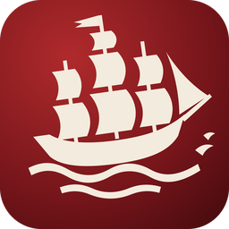
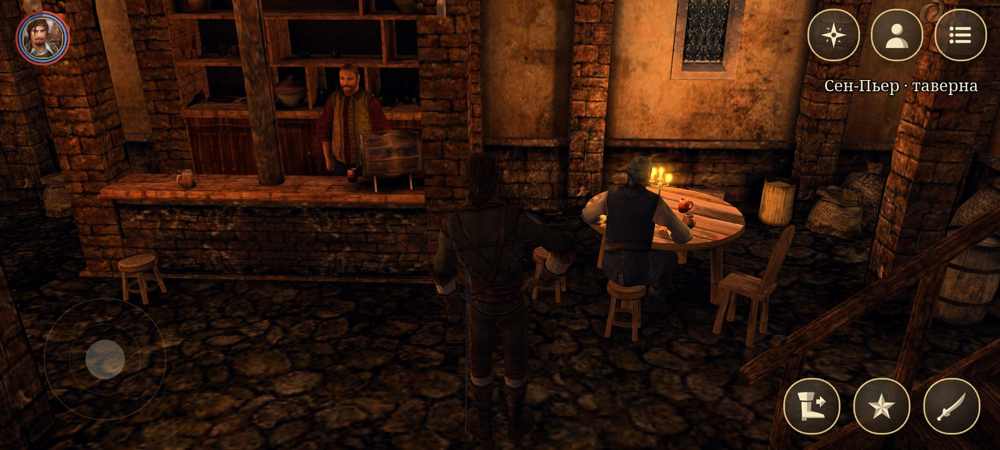
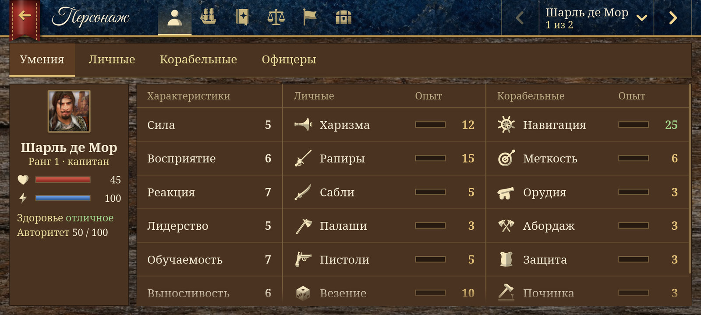

[English](README.md) | **Русский**

<p align="center"></p>

# Seawolves

«Корсары: Каждому своё» на телефоне с Android — из вашей собственной копии игры.

Seawolves — неофициальный фанатский порт: сенсорный интерфейс и перенос открытого движка игры,
[Storm Engine](https://github.com/storm-devs/storm-engine). **Файлов игры в нём нет** — нужна своя легально
полученная копия.

**Состояние: первая публичная альфа.** Игра запускается, идёт и сохраняется; полное прохождение не проверено.
Ошибки будут — пожалуйста, [сообщайте о них](#как-сообщить-об-ошибке).

<p align="center">
  
</p>
<p align="center">
  
</p>
<p align="center">
  
</p>

<sub>Графика игры на скриншотах принадлежит её правообладателям и не покрывается лицензией этого репозитория
([NOTICE](NOTICE)).</sub>

## Быстрый старт

1. **Возьмите игру**: версия `ver. 1.7.3 (26.11.21) x64`, установленная на компьютере либо в виде архива или
   установщика.
2. **Установите приложение**: скачайте APK со страницы [Releases](https://github.com/maxyo/seawolves/releases),
   откройте его на телефоне и разрешите установку, когда Android спросит.
3. **Импортируйте игру**: запустите Seawolves, откройте **«Файлы игры»** и выберите папку игры, её архив ZIP, 7z
   или RAR либо `setup.exe` вместе со всеми `setup-*.bin`.
4. **Играйте.**

Другие версии игры тоже запускаются, но исправления скриптов применяются только к 1.7.3.

## Требования

| | Минимум | Рекомендуется |
|---|---|---|
| Android | 8.0 | 12 и новее |
| Процессор | 64-битный ARM | 64-битный ARM |
| Оперативная память | 4 ГБ | 8 ГБ |
| Свободное место | 15 ГБ | 20 ГБ |
| GPU | средний класс 2021 года и новее | флагман 2023 года и новее |

Играли на Galaxy S24, Xiaomi 15 Ultra и Pixel 10 Pro.

<details>
<summary>GPU подробно и что проверено</summary>

| Семейство GPU | Минимум | Рекомендуется | Слишком медленно |
|---|---|---|---|
| Adreno | 642L, 644, 660, 710, 720 | 740, 750, 830 | 610, 612, 618, 619 |
| Mali | G68 MC4, G610 MC6, G615, G715 MC7 | — | G52, G57 |
| Immortalis | все | G715 MC11, G720, G925 | — |
| Xclipse | 530, 540, 920 | 940, 950 | — |
| PowerVR | D-Series DXT-48-1536 | — | GE8320, GE8322 |

- Игра рисует через Vulkan 1.1 там, где драйвер телефона для этого годится, иначе через OpenGL ES 3.2.
- На минимуме она идёт на пресете «Низкая»; рекомендуемые GPU тянут «Среднюю» или «Высокую».
- Нужно 0,6–1,1 ГБ оперативной памяти и 12,7 ГБ места под игру, плюс до 2 ГБ кэшей.
- **Играли**: Galaxy S24 (Adreno 750), Xiaomi 15 Ultra (Adreno 830), Pixel 10 Pro (PowerVR D-Series, OpenGL ES).
- **Измерены запуск, загрузка сохранения и пресеты**: Galaxy S23 (Adreno 740), Galaxy S21 (Adreno 660), Galaxy A56
  (Xclipse 540), Pixel 8 (Mali-G715), на Android 12 и 16.
- **Не поддерживается**: Galaxy A12 (PowerVR GE8320), 2–5 кадров в секунду.
- Всё остальное в таблице — оценка по открытым тестам GPU, а не измерение.

</details>

## Полезно знать

- **Удаление приложения стирает игру и сохранения.** Сначала отправьте сохранения кнопкой **«О программе» →
  «Отправить сохранение»**, потом верните их кнопкой **«Восстановить сохранение»**.
- **Обновления** ставятся поверх прежнего релиза и ничего не теряют.
- **«Скачать»** в приложении загружает копию, на которую у вас есть право, по вашему torrent-файлу или
  magnet-ссылке. Ссылок на игру в приложении нет.
- **«Обработка текстур»** («Настройки» → «Звук и графика»): «Карты нормалей», «Параллакс» и «Апскейл текстур ×2»,
  по умолчанию выключены. Телефон создаёт их сам из ваших файлов игры.
- **Графика ПК-сборки** — не пресеты, а отдельные настройки каждой возможности движка, по умолчанию полное качество;
  они хранятся для каждой игры в её `engine.ini` в папке настроек игрока. Список:
  [engine/README.md](engine/README.md#graphics-options).

<details>
<summary>Проверка скачанного файла</summary>

```sh
sha256sum --check SHA256SUMS
apksigner verify --print-certs seawolves-<version>-arm64.apk
# Signer #1 certificate SHA-256 digest: 31c67a4b0d1471f1e800dc498b07b0c65d5268167bfc7b578fb8dd5f6e7879ea
```

Все релизы подписаны этим одним ключом. Сборка из исходников подписана другим ключом, поэтому не может обновить
релиз, а релиз не может обновить её.

</details>

## Что оно умеет

- Сенсорное управление на суше, в море и на глобальной карте, с вибрацией и раскладкой под левую руку.
- Переработанный интерфейс на русском, английском, немецком, испанском, французском и итальянском.
- Vulkan или OpenGL ES, три пресета качества с автоматическим выбором, переработанные свет и тени.
- Ролики игры, автосохранения, отправка и восстановление сохранений.
- Исправления ошибок в скриптах самой игры. Пираты на глобальной карте по умолчанию встречаются реже
  («Настройки» → «Частота пиратов на карте»).

Изменения по версиям — в [списке изменений](CHANGELOG.md).

## Как сообщить об ошибке

В лаунчере откройте **«О программе» → «Поделиться отчётом»** и приложите файл к новому сообщению в
[Issues](https://github.com/maxyo/seawolves/issues). Если ошибка зависит от сохранения, добавьте его кнопкой
**«Отправить сохранение»**. Об уязвимостях — [SECURITY.md](SECURITY.md).

## Планы

Без сроков и обещаний: порт на iOS, менеджер модов, другие игры серии «Корсары» и Caribbean Legend.

## Сборка

На Linux с JDK 17, Python 3.12+, CMake, Ninja, компилятором C++, FFmpeg, curl, unzip, patch, Perl и make:

```sh
git clone https://github.com/maxyo/seawolves.git
cd seawolves
bash app/tools/android/build_debug.sh
```

Первая сборка скачивает Android NDK и SDK и кладёт отладочный APK в `app/build/dist/`. Файлы игры для сборки не
нужны. Подробнее — в [CONTRIBUTING.md](CONTRIBUTING.md), [руководстве по приложению](app/tools/android/README.md) и
[README движка](engine/README.md).

| Путь | Что |
|---|---|
| `app/android/` | Android-оболочка: лаунчер, импорт игры, игровая активность |
| `app/mobile-ui/` | сенсорный интерфейс и его скрипты |
| `app/script-patches/` | исправления скриптов игры в виде диффов |
| `app/tools/android/`, `app/tests/` | упаковка, инструменты выпуска, проверки |
| `engine/` | нативный движок: C++, рендерер и его шейдеры, тесты и инструменты |

## Лицензия и благодарности

[GPL-3.0](LICENSE): движок, интерфейсные скрипты и исправления скриптов — GPL-3.0-only, остальное приложение —
GPL-3.0-or-later. Подробности и происхождение каждого шрифта, значка и текстуры — в [NOTICE](NOTICE); сторонние
библиотеки перечислены в [engine/third_party/README.md](engine/third_party/README.md).

Движок — форк [storm-devs/storm-engine](https://github.com/storm-devs/storm-engine) (`develop` на `a68f43df`).
Спасибо авторам Storm Engine и игры за открытый код и сообществу storm-devs, которое его поддерживает и
опубликовало скрипты игры в [sd-teho-public](https://github.com/storm-devs/sd-teho-public). Спасибо также Claude и
Codex — ИИ-ассистентам, которые помогали писать этот порт.

Dustoff — название студии, под которым выходит Seawolves.

## Отказ от ответственности

Seawolves не связан с разработчиками, издателями и правообладателями «Корсаров: Каждому своё» и серии «Корсары» и
не одобрен ими; их названия и товарные знаки принадлежат владельцам. Содержимое игры не входит в проект и не
покрывается его лицензией. Проект не распространяет игру: используйте свою копию. Программа поставляется без
гарантий.
